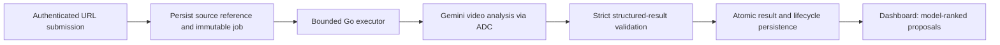

# ADR-005: Direct YouTube analysis with managed Gemini

Status: accepted for the phased migration; G1 is complete, G2 persistence is in development and G3 orchestration is in design/foundation work. This decision supersedes ADR-004's download-first/Modal architecture for future Gemini analysis; the current dashboard still starts legacy analysis. Legacy records and unrelated generation behavior remain supported during migration. No deployment or live provider validation is implied.

## Context

The existing clipping workflow acquires local media, dispatches speech/visual analysis to Modal, and uses Go heuristics to select candidates. It requires downloader maintenance and local storage before the user can obtain an analysis. It also assigns creative decisions to a separate algorithm rather than the multimodal model requested by the user.

## Decision

Keep the existing cohesive Go service, authenticated dashboard, SQLite store, persistent volume and job lifecycle. Use the official Google Gen AI Go SDK with ADC and a fixed managed Google endpoint. Do not introduce a hosted agent, queue service, second database or media staging service. A service account attached to a Google Cloud runtime is the preferred production identity; an external host needs supported workload identity federation before enablement. Long-lived API keys and service-account key files are not the deployment strategy.

A canonical public YouTube URL is a model video input. Gemini chooses candidates, hooks, titles, proposed start/end boundaries, explanations, evidence, scores and rank. The backend validates the versioned result, preserves order and values, and stores it. Invalid output cannot be repaired by local rescoring, trimming, quota filling or replacement selection. No downloader or local media inspection belongs to this provider path.

Media extraction is a separate future capability. There is no extraction arrow in the current flow. `youtube-extractor-rs` is outside this phase.

## Persistence and compatibility

A URL reference is a distinct source kind, with encrypted canonical URL and rights attestation. It has no local path, byte size, media SHA-256 or independently measured duration. Ready means the reference was accepted, not that Google proved the video accessible. Model-reported duration belongs to the result.

Legacy files, sources, jobs and artifacts remain readable. Eligible saved YouTube files may be reanalyzed remotely from their stored URL without reading or changing their media. A provider snapshot, rather than source kind alone, selects the analysis protocol. Every legacy claim, cache, callback and recovery boundary must reject Gemini jobs.

Each Gemini job stores immutable routing, model, prompt/schema versions, exact millisecond options and a deterministic request fingerprint. Source URLs remain encrypted in their owning source record. The executor recomputes the fingerprint from the current deterministic request before submission; code/configuration drift fails before inference. The fingerprint is not a media hash and cannot prove that content at a URL is unchanged.

Cache identity includes the source and complete request fingerprint. Cached results require a completed, nondeleted origin job, have a bounded lifetime no longer than source retention, and retain origin/usage provenance. Reuse must not invent a fresh provider charge. Deletion and expiry invalidate eligible cached results.

SQLite constraint changes require a private, consistent, durable backup and atomic source/job rebuild. Preserve dependent views, triggers, indexes and foreign keys. Failed/repeated startups must not create unbounded managed snapshots. Existing Windows databases preserve ordinary app startup when a durable backup cannot be established; the new reference capability remains unavailable rather than partially migrating.

## Reliability and release gates

Persist submission intent before provider work. Limit concurrency and deadlines. Distinguish known non-submission, explicit rejection, received unusable output and unknown post-submission outcomes. An ambiguous outcome is quarantined across restart and user idempotency keys; it does not authorize automatic inference replay. Completion checks the current attempt, lease, cancellation, deletion and retention atomically. Store actual available usage even when the semantic result is invalid.

The initial model is `gemini-3.8-flash`, with static processing and a conservative 40-minute model-reported duration ceiling. YouTube input is Preview and may be unavailable for a particular public video. Documentation and mocks do not prove source coverage, semantic quality, language performance, latency or cost. Those require an authorized, measured release evaluation. Four-hour support and a chunked aggregation architecture are not assumed.

Scores are editorial estimates; timestamps are proposed boundaries. The UI must preserve Gemini's ranking, show context and limitations, and avoid presenting remote references as playable local files. Google enablement, deployment and legacy retirement have separate readiness/drain gates. See the [migration plan](../clipping/GEMINI-MIGRATION.md) and [provider contract](../clipping/GEMINI-PROVIDER.md).
